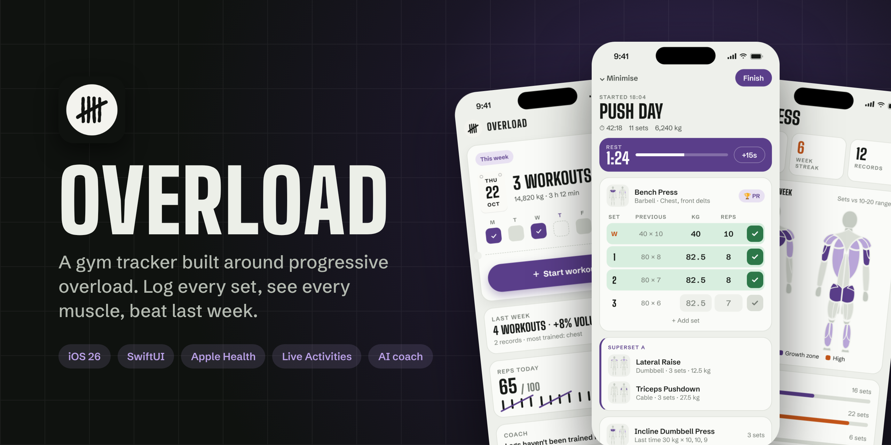
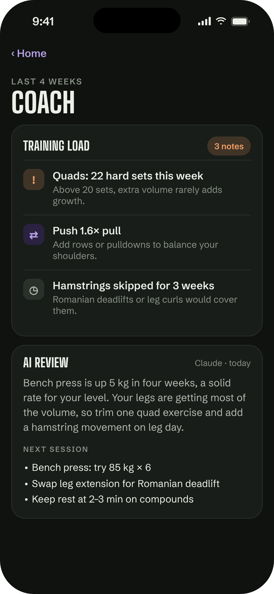
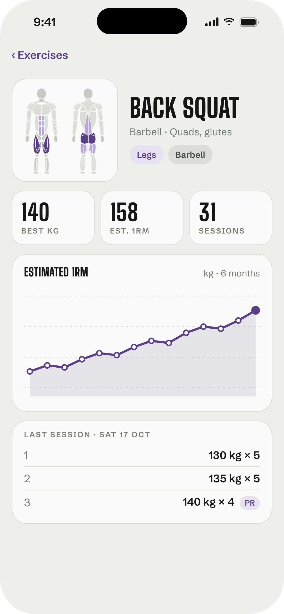

<p align="center">
  
</p>

<p align="center">
  <a href="https://github.com/Sadraiii/RepCounter/actions/workflows/tests.yml"></a>
  
  
  
  
</p>

<p align="center">
  <b>Log every set. See every muscle. Beat last week.</b><br>
  Overload is a native iPhone gym tracker that compares each set with the last session, shows which muscles you trained, and nudges you to add a little more every week.
</p>

---

## Screenshots

<table>
  <tr>
    <td align="center"><br><sub><b>Home</b>: your week at a glance</sub></td>
    <td align="center"><br><sub><b>Workout</b>: sets vs last time, rest timer</sub></td>
    <td align="center"><br><sub><b>Progress</b>: weekly muscle volume</sub></td>
  </tr>
  <tr>
    <td align="center"><br><sub><b>History</b>: calendar with Apple Watch workouts</sub></td>
    <td align="center"><br><sub><b>Coach</b>: training-load check and AI review</sub></td>
    <td align="center"><br><sub><b>Exercise</b>: muscles, records and 1RM trend</sub></td>
  </tr>
</table>

> [!NOTE]
> These are design mockups drawn with the app's own colours, fonts and muscle figure, with sample data. They are not simulator captures. Regenerate them with `node scripts/mockups/render.js`.

## Features

### 🏋️ Training
- **Workout logging** with warm-up, drop and failure sets, a rest timer that follows you to the Lock Screen, and a **Live Activity** in the Dynamic Island.
- **Previous set beside every set**, plus a suggested weight based on last time, so progressive overload is the default.
- **Supersets**: link exercises and the rest timer starts after the last one.
- **Plans**: saved workouts you start in one tap.
- **126 exercises** across barbell, dumbbell, machine, cable and Smith machine, plus your own. Weighted and assisted bodyweight, and distance exercises with time and pace.
- **Tools**: interval timer and plate calculator.

### 📈 Progress
- **Muscle map**: a front and back figure for every exercise, and a weekly heat map shaded against the 10–20 sets growth range.
- **Records and estimated 1RM** charts per exercise.
- **Weekly recap** each Monday, workouts and volume per week, and week streaks.
- **History** with a month calendar.

### 🤖 AI coach
- A **training-load check** that flags muscles over 20 hard sets a week, sudden jumps, hard sessions under 48 h apart, push/pull and quad/hamstring imbalances, and muscles skipped for three weeks. It runs on the phone and needs no key.
- **Coach feedback** on a workout or on the last four weeks, written by Claude for your goal (muscle, strength, fitness or fat loss). See [AI coach setup](#ai-coach-setup).

### ❤️ Apple Health and sharing
- Steps, energy and body weight from **Apple Health**, and workouts saved back to it.
- **Apple Watch** and other apps' workouts show in History. A Watch workout recorded during an Overload workout is merged into it instead of being saved twice.
- **Home and Lock Screen widgets** for training and reps.
- **Share cards** for workouts, weeks and reps as Instagram stories or stickers.
- **Export** workouts as a spreadsheet (CSV), a plain-text training log, or a full JSON backup.

### ✋ Rep counter
- A quick tally counter with a daily goal, on Home and in a widget.

## Getting started

Overload targets **iOS 26.1** and is built with [xtool](https://github.com/xtool-org/xtool) from [`xtool.yml`](xtool.yml), so it builds from Linux or WSL as well as macOS.

```sh
git clone https://github.com/Sadraiii/RepCounter.git
cd RepCounter
xtool dev            # build, sign and install on a connected iPhone
```

The app's logic that doesn't need UIKit lives in [`Packages/TallyCore`](Packages/TallyCore) and has unit tests that run on Linux. CI runs them on every push and pull request.

```sh
cd Packages/TallyCore && swift test
```

### AI coach setup

The coach uses your own [Anthropic API key](https://console.anthropic.com/settings/keys) (it starts with `sk-ant-`).

1. Open the **Coach** card on Home and tap **Connect Claude**.
2. Paste your key. It is stored in this iPhone's **Keychain** and is never committed to the repo or bundled in the app.
3. Pick a model and your goal in **Settings › AI coach**. Claude Haiku is the default to keep each request cheap.

Your last four weeks of workouts are sent to Anthropic only when you ask for feedback, and requests are billed to your API account. The training-load check works without a key.

## Project layout

| Path | What's there |
| --- | --- |
| [`Sources/Tally`](Sources/Tally) | The app: SwiftUI views, the gym store, Health sync, coach, share and export |
| [`Sources/TallyKit`](Sources/TallyKit) | Theme, fonts and data shared by the app and the widget |
| [`Sources/TallyWidget`](Sources/TallyWidget) | Home and Lock Screen widgets and the workout Live Activity |
| [`Packages/TallyCore`](Packages/TallyCore) | Plain-Swift logic with Linux tests: recaps, supersets, overlap matching, pace, export, training load |
| [`Assets`](Assets), [`scripts`](scripts) | Icon sources, the anatomy figure generator and the README mockups |

## Naming

The app was first called Tally and its display name is now **Overload**. Code-level names (the `Tally`, `TallyKit`, `TallyCore` and `TallyWidget` targets), the bundle ID and the `tally://` URL scheme are unchanged, so installed data, widgets and deep links keep working.

## Credits

Fonts: [Big Shoulders Display](https://fonts.google.com/specimen/Big+Shoulders+Display) and [Schibsted Grotesk](https://fonts.google.com/specimen/Schibsted+Grotesk), both under the SIL Open Font License (see [`Resources/Fonts`](Resources/Fonts)).
