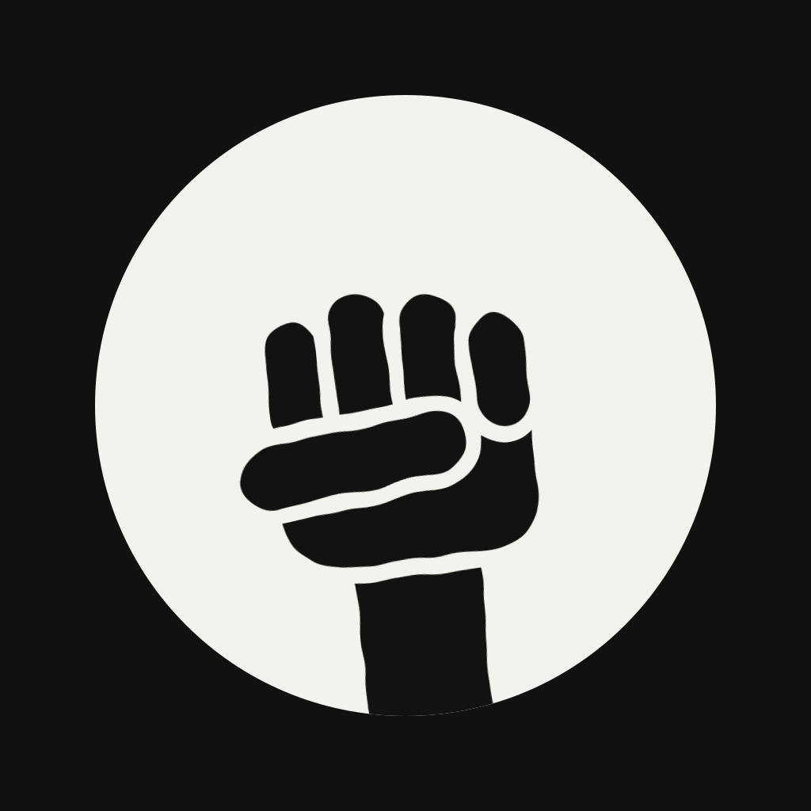
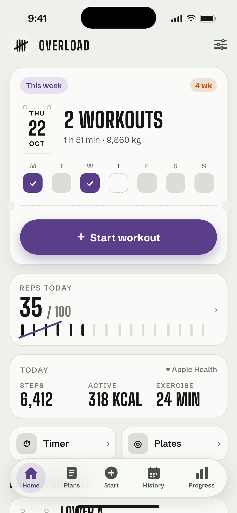
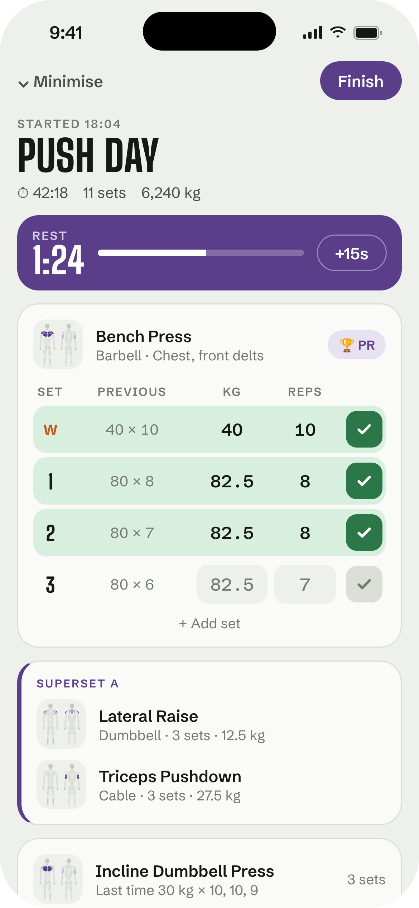
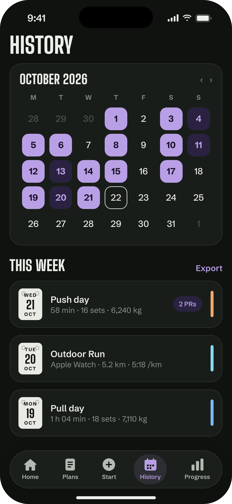
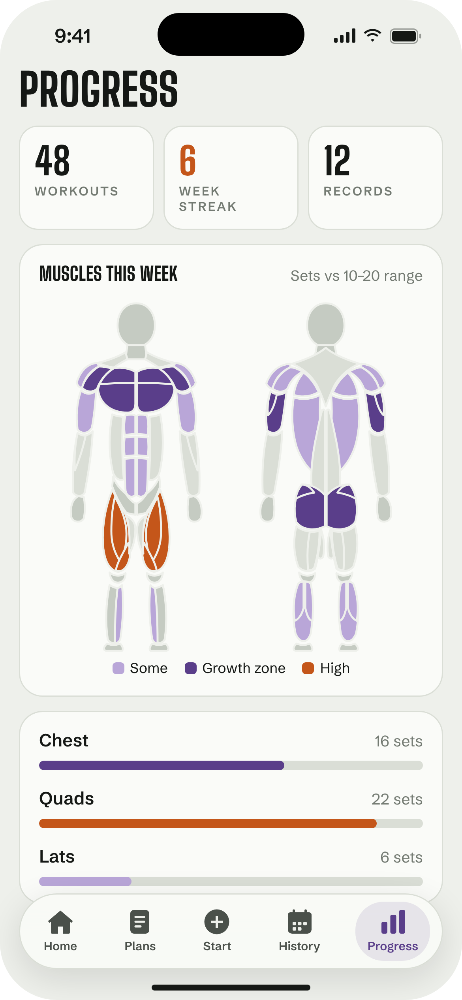

# Overload

Gym tracker for iPhone.

<p>
  
  
  
  
</p>

<sub>Mockups, not simulator screenshots.</sub>

- Workouts, plans, supersets and a rest timer
- Muscle map, records and weekly recap
- Calorie and macro tracking with food search and barcode scanning ([Open Food Facts](https://world.openfoodfacts.org))
- Sleep tracking, sleep score, bedtime reminders and a wind-down routine
- Apple Health and Apple Watch workouts
- Widgets and a Live Activity
- Export to CSV, text or JSON
- AI feedback with your own Anthropic API key, stored in the Keychain

## Build

Needs iOS 26.1. Built with [xtool](https://github.com/xtool-org/xtool):

```sh
xtool dev
```

Tests:

```sh
cd Packages/TallyCore && swift test
```
